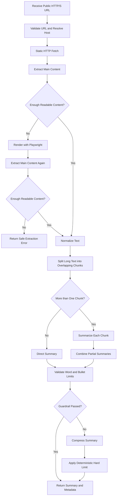

# Part 2: Technical Implementation

## 1. Assumption

The challenge prompt refers to an existing script, but no starter script was included in the provided challenge document. This solution therefore assumes a common baseline implementation that downloads a page with a basic HTTP request, extracts all visible text, and sends the entire page to a language model in one request.

A simplified version of that baseline would resemble:

```python
html = requests.get(url).text
text = BeautifulSoup(html, "html.parser").get_text()
summary = summarize_with_llm(text)
```

This approach works for a small static page but fails on complex and long pages.

## 2. Identified Bottlenecks

### 2.1 Static-only Fetching

A basic HTTP request returns the server-provided HTML but does not execute JavaScript. On client-rendered websites, the returned HTML may contain only a loading shell, causing the extractor to return little or no meaningful content.

### 2.2 No Main-content Extraction

Extracting all visible text includes navigation menus, cookie banners, advertisements, related links, headers, footers, and repeated interface elements. This creates noisy input and reduces summary quality.

### 2.3 Unbounded Input to the Model

Sending an entire long webpage in one model request increases token usage, latency, timeout risk, and the probability of exceeding the model's input limit. It also makes important information easier to miss.

### 2.4 Prompt-only Conciseness Control

An instruction such as "be concise" is not a reliable length limit. Model output is probabilistic, so the application must measure and enforce the final output boundary.

### 2.5 Missing Operational and Security Controls

A naive scraper often lacks URL validation, redirect validation, timeouts, content-type checks, response-size limits, structured errors, and logging. This can cause hanging requests, excessive downloads, or server-side request forgery against private services.

## 3. Proposed Architecture



## 4. Implementation

### 4.1 Safe Static Fetching

`StaticFetcher` uses a bounded HTTP request as the fast path. It applies:

- HTTP and HTTPS scheme validation;
- DNS resolution and private-IP blocking;
- validation of every redirect target;
- connect/read timeout handling;
- a maximum redirect count;
- an allowed content-type list; and
- a maximum response size.

Static fetching is attempted first because it is faster and less resource-intensive than running a browser.

### 4.2 JavaScript-rendering Fallback

After static fetching, the system extracts the main content and checks its size. If the result is too short to be meaningful, `BrowserFetcher` loads the page with headless Chromium through Playwright. The rendered HTML is then passed through the same extraction pipeline.

The browser is a fallback rather than the default because it consumes more memory and CPU. A page that remains empty after browser rendering returns a controlled extraction error instead of an invented summary.

### 4.3 Main-content Extraction

Trafilatura is used to identify the main article text and remove common boilerplate such as repeated navigation and footer content. Comments are excluded, while tables may be retained because they can contain important article information.

A small standard-library HTML parser is included as a minimal fallback. It keeps the tests and offline demonstration usable, but Trafilatura is the preferred production extractor.

### 4.4 Long-content Chunking

The normalized text is split into chunks of at most 1,200 words with a 100-word overlap. The overlap reduces the chance of losing context at a chunk boundary.

If the page fits in one chunk, the system performs a direct summary. For a longer page, it uses map-reduce summarization:

1. **Map:** summarize each chunk independently.
2. **Reduce:** combine the partial summaries into one coherent final summary.

The limits are configurable because the appropriate values depend on the selected model and expected webpage size.

### 4.5 Summary Generation

The implementation defines a `TextSummarizer` interface. The main implementation uses the OpenAI Responses API, while an offline extractive implementation is provided for testing and demonstration without an API key.

The model instruction treats webpage content as untrusted data. Commands contained in the scraped page are ignored, and the model is instructed to use only facts present in the supplied text. This reduces prompt-injection and unsupported-fact risk.

### 4.6 Conciseness Guardrail

The final summary has a default limit of 150 words and five bullet points. Conciseness is enforced in three layers:

1. The generation instruction requests the required maximum.
2. The application counts words and bullet points after generation.
3. If the result violates a limit, the model receives one compression request. A deterministic final boundary then removes excess bullets and trims the summary to complete sentences within the word limit.

This design does not rely on prompt compliance alone.

## 5. Error Handling

| Failure | Behaviour |
| --- | --- |
| URL is not HTTP/S | Reject before fetching |
| URL resolves to localhost or a private/reserved IP | Reject as unsafe |
| Redirect points to a blocked address | Reject the redirect target |
| Request times out or returns an HTTP error | Return a structured fetch error |
| Response exceeds the configured size | Stop downloading and return an error |
| Response is not HTML or text | Reject as unsupported content |
| Static extraction is too short | Attempt Playwright fallback |
| Browser extraction is still too short | Return a controlled extraction error |
| Model request fails | Return a controlled model error rather than fabricated output |
| Summary exceeds its output limit | Compress once, then apply deterministic limits |

In production, transient fetch and model errors could be retried with exponential backoff and jitter. Retries should be bounded to avoid multiplying load during an outage.

## 6. Guardrail Example

Configuration:

```python
MAX_SUMMARY_WORDS = 150
MAX_SUMMARY_BULLETS = 5
```

Validation:

```python
violations = guardrail_violations(
    draft,
    max_words=MAX_SUMMARY_WORDS,
    max_bullets=MAX_SUMMARY_BULLETS,
)

if violations:
    draft = summarizer.summarize(
        draft,
        max_words=MAX_SUMMARY_WORDS,
        purpose="compress",
    )

final_summary = enforce_summary_guardrail(
    draft,
    max_words=MAX_SUMMARY_WORDS,
    max_bullets=MAX_SUMMARY_BULLETS,
)
```

## 7. Testing Strategy

The deterministic unit tests do not call live websites or model APIs. They cover:

- public, private, local, and unsupported URLs;
- removal of common webpage boilerplate;
- insufficient static extraction and browser fallback;
- safe failure when neither strategy finds content;
- chunk-size and overlap guarantees;
- map-reduce orchestration for long input; and
- final word and bullet limits.

Separate integration tests can be added for approved test websites and a configured model account. Keeping network tests separate prevents ordinary unit tests from becoming slow or flaky.

## 8. Observability

A production deployment should emit structured logs and metrics for:

- sanitized source hostname;
- static or browser fetch method;
- response size and content type;
- extracted word count;
- chunk count;
- model request count and latency;
- final summary word count;
- guardrail violations and compression attempts; and
- final success or error category.

Full scraped content and API credentials must not be written to logs.

## 9. Trade-offs

### Static Fetching vs. Browser Rendering

Static HTTP requests are fast and inexpensive but cannot render JavaScript-dependent content. Browser rendering supports complex pages but uses more CPU, memory, and time. The system therefore uses static fetching first and starts Playwright only when extraction is insufficient.

### Extraction Precision vs. Recall

Aggressive boilerplate removal produces cleaner text but can accidentally remove useful sidebars, tables, or captions. The extractor favors main-content precision while retaining tables and failing safely when the result is too short.

### Chunk Size vs. Context Preservation

Smaller chunks are easier to process but may split related information. Larger chunks preserve more context but increase token usage. Configurable chunks with overlap provide a practical balance.

### Strict Length Limits vs. Completeness

A hard 150-word limit ensures a concise result but may omit secondary details from a long article. The map-reduce step preserves the most important points before the final boundary is applied.

## 10. Conclusion

The main bottleneck is not a single slow line of code. It is an unbounded pipeline that assumes every page is static, extracts noisy text, sends the entire result in one model request, and trusts the model to remain concise. The revised implementation introduces a fast static path, browser fallback, main-content extraction, bounded map-reduce summarization, URL and response controls, deterministic output validation, tests, and observable failure modes.

